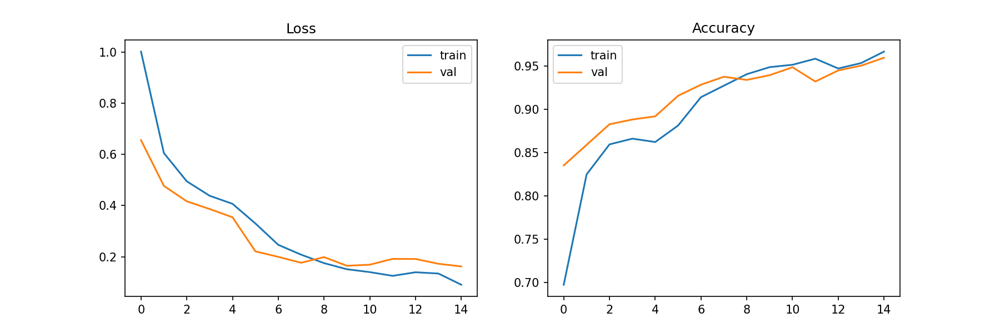
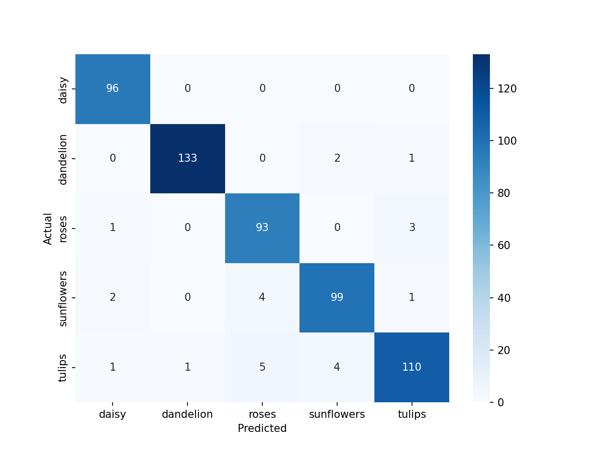

# Image Classifier (ResNet50 Transfer Learning)

Fine-tuned ResNet50 image classifier with a Gradio demo.

## Dataset
Flowers dataset (5 classes, ~3600 images). Split 70/15/15.

## Model
- ResNet50 pretrained on ImageNet
- Phase 1: frozen backbone, train classifier head (5 epochs)
- Phase 2: fine-tune layer4 with low LR (10 epochs)

## Results
- Test accuracy: XX%

## How to run
pip install -r requirements.txt
python app.py

## Model weights
Download from: <your Hugging Face / LFS link>
